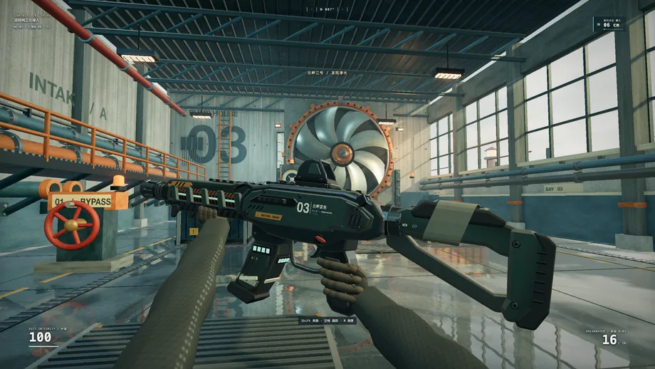
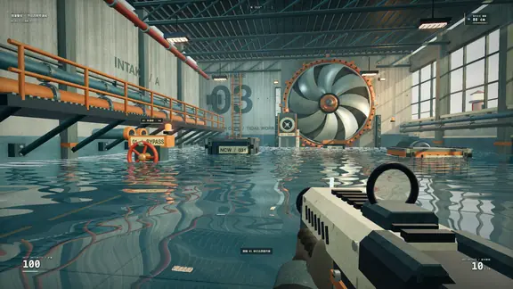
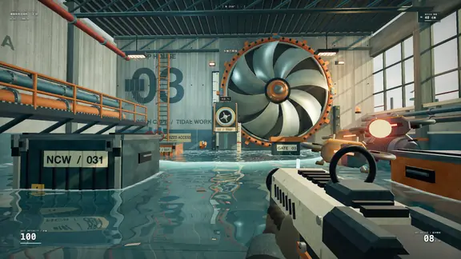
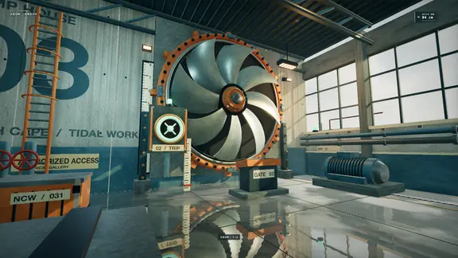

# Tidemark: Backflow

[简体中文](README.md) · **English**

## [▶ Play in your browser][play]

Three waves of rogue inspection drones. One flooding pump room. When the water climbs past the crates, your R-03 Breakwater pulse rifle is no longer the only way to fight back.

[![Play Tidemark: Backflow — a pressure wave rolls across the floor of Pump Room 03][cover]][play]

**[Watch 20 seconds of gameplay (1080p60, sound on)][film]** · [Download the single HTML file and play offline][offline]

### Your first shift

Open the game in a WebGL browser and click the orange **进入三号泵房** (“Enter Pump Room 03”) button. The in-game interface is in Chinese; the numbered markers and the guide below will get you through the room. Try it with headphones: you can hear the bypass valve open and the main pump spin up.

| | Controls |
| :--- | :--- |
| Move | **WASD** to move, **Shift** to sprint, **Space** to jump. |
| Fight | Move the mouse to aim. **Left click** fires, **right click** looks through the sight, **R** swaps magazines, **V** inspects the rifle. |
| Operate equipment | Walk up to a valve or pump and press **E**. **Esc** pauses. |
| Touch | Move with the left stick; drag on the right to aim. Hold **发射** (Fire) and drag to shoot, tap **换匣** to reload, or tap the ammo count to inspect. Tap **旁通** (Bypass) or **主泵** (Main pump) when prompted. Both orientations work; landscape gives you a wider view. |

<details>
<summary>Inspect the Breakwater: the pump crew's “03” stencil in game</summary>



[Watch the magazine change (3 seconds, 1080p60, with sound)](https://github.com/ericyanpek/astra62-fps-demo/releases/download/v2.1.0/r03-reload-1080p60.mp4)

</details>

Just ahead and a little left of the entrance, steel inspection covers ring under your boots. In wave two, watch the two patrols cross: a wake under a drone means it is low enough for the water hammer. In wave three, two rising tones warn that a mast drone has marked the floor under you. Step outside the double ring before it closes.

### Put the water to work

| 01 · Flood | 02 · Water hammer | 03 · Drain |
| :--- | :--- | :--- |
| [](media/backflow.webp) | [](media/waterhammer.webp) | [](media/low-water.webp) |
| When seawater floods the room, follow **01** to the red bypass valve on the west side. Open it. | Wait for drones to skim the water, then shoot the **yellow ring** by the impeller. The pressure wave catches low drones. Aim your rifle at the ones flying above it. | Once the drones are down, follow **03** to the main pump and start it. Stay a moment and watch the waterline fall. |

Click any frame for the full 2560 × 1440 lossless capture. The [short film][film] uses the game's own audio, with travel and wave delays trimmed. There's also a [1080p gameplay still](media/readme/showcase-waterhammer.jpg).

### What changed when Astra got another turn?

GPT-6.2 Astra built the [first playable version][v1] in Codex from a single creative brief. The [original FPS prompt][prompt-source] asked for a small, visually detailed level. The build had to fit in one HTML file, with no external models, textures or audio. Astra could playtest and revise its work along the way.

In that version, the water reflected the pump room, but you could stand in the doorway and finish all three waves. After saving a checkpoint, the author gave Astra one more creative turn: decide what to improve without looking at the comparison game. Astra made the room flood, put the bypass valve across the water, and gave the player a reason to wait for drones to fly low. Later playtests refined movement, footsteps and the three patrols, and introduced the R-03 Breakwater, a pulse rifle salvaged from the floodwall crew. You can read [both prompts](docs/experiment.md) or compare the [checkpoint][v1] with the [Backflow release][v2].

<details>
<summary><strong>Run, build, test or record locally</strong></summary>

Double-click `index.html` to play offline. Three.js is bundled, and the scenery, materials and sound are generated by code. The game needs no server, account or API key.

- Hold the right mouse button to sight through the optic. Press **V** (or tap the ammo count on touchscreens) to inspect the rifle. The offline build embeds the mesh. The [original Blender model and export script](tools/art/breakwater) are included; only re-exporting the mesh requires Blender and liblz4.
- `python3 src/build.py` rebuilds `index.html` from `src/`. No npm install is needed to build or play.
- [`src/hydraulics.js`](src/hydraulics.js) controls the water level, bypass valve and pressure wave. Three.js ships with [its own license](src/LICENSE.three); the source prompt is credited under [its original license](docs/LICENSE.prompts).
- To run the browser checks or record footage, install Node.js, Playwright and Chrome. Recording also needs FFmpeg. `PLAYWRIGHT_MODULE` can point to an existing Playwright installation.

```sh
npm install --no-save --package-lock=false playwright
node tools/verify.cjs artifacts/qa
node tools/verify-phone.cjs
node tools/record.cjs
```

The gameplay checks cover victory, restart after defeat, cover collisions and water-hammer hits. The phone checks simulate portrait and landscape on an iPhone 15 Pro Max, including space taken by browser bars and safe areas. To run the phone checks in WebKit, install Playwright WebKit and set `PHONE_ENGINE=webkit`. The recorder writes its footage to `artifacts/`.

</details>

[play]: https://ericyanpek.github.io/astra62-fps-demo/
[cover]: media/readme/backflow-cover.webp
[film]: https://github.com/ericyanpek/astra62-fps-demo/releases/download/v2.0.0/backflow-1080p60.mp4
[offline]: https://github.com/ericyanpek/astra62-fps-demo/releases/download/v2.1.0/tidemark-backflow.html
[v1]: https://github.com/ericyanpek/astra62-fps-demo/tree/v1.0.0
[v2]: https://github.com/ericyanpek/astra62-fps-demo/releases/tag/v2.0.0
[prompt-source]: https://github.com/wquguru/fable52-fps-repro/tree/a7e1df3ce32eb2bb05e23ae457fe5fe2bffab961
