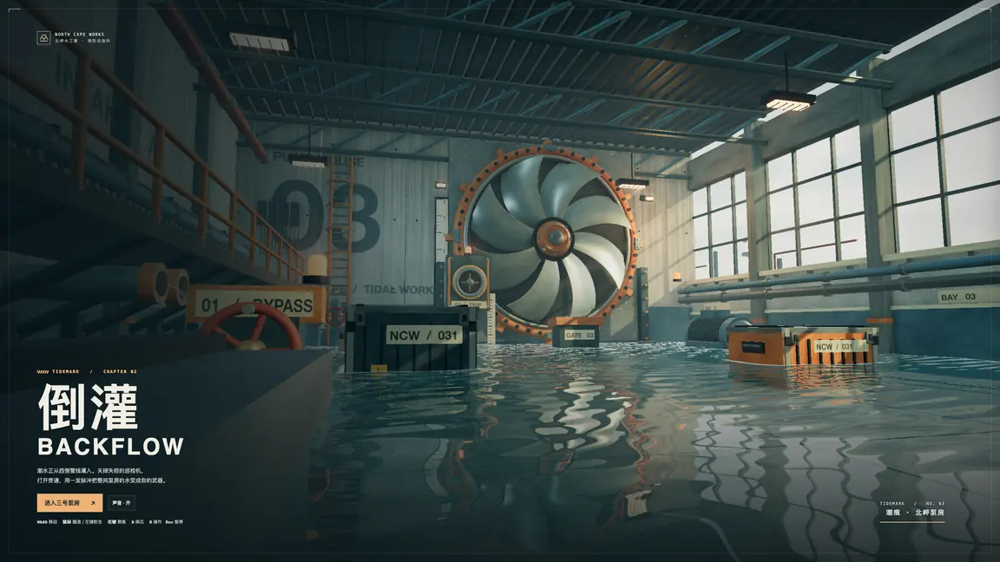
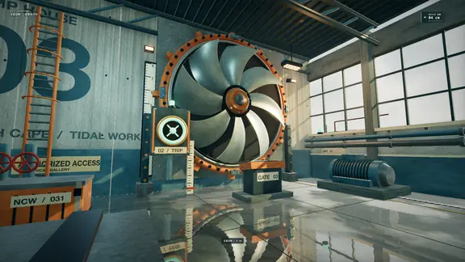

# 潮痕：倒灌 · TIDEMARK / BACKFLOW

海水正在灌进北岬三号泵房。你有一把脉冲铆枪，还可以把整间泵房变成武器：拧开红阀，等贴水巡检机聚到一起，朝叶轮旁的黄环打一发。

**[▶ 在线试玩](https://ericyanpek.github.io/astra62-fps-demo/)** · [下载离线版 · 单个 HTML](https://github.com/ericyanpek/astra62-fps-demo/releases/download/v2.0.0/tidemark-backflow.html) · [下载实机短片 · 1080p / 60 fps / 有声](https://github.com/ericyanpek/astra62-fps-demo/releases/download/v2.0.0/backflow-1080p60.mp4) · [第一版 checkpoint](https://github.com/ericyanpek/astra62-fps-demo/tree/v1.0.0)

[](media/title.webp)

## 怎么玩

用支持 WebGL 的浏览器打开[在线试玩](https://ericyanpek.github.io/astra62-fps-demo/)，点击标题画面的按钮即可进入泵房，无需账号。想离线玩，可以下载上面的 HTML，或克隆本仓库后直接打开根目录的 `index.html`。场景、贴图和声音都由代码生成。

| 操作 | 键鼠 |
| --- | --- |
| 移动 / 奔跑 / 跳跃 | WASD / Shift / 空格 |
| 瞄准 / 发射 / 聚焦 | 鼠标移动 / 左键 / 右键 |
| 换芯 / 开阀或启动主泵 / 暂停 | R / E / Esc |

触屏可以用左侧摇杆移动，拖动画面瞄准。右侧按钮控制射击和换芯，交互按钮在需要时出现。

## 一个房间里的三种水位

| 倒灌 | 泄压 | 退潮 |
| :---: | :---: | :---: |
| [](media/backflow.webp) | [](media/waterhammer.webp) | [](media/low-water.webp) |
| 去西边开启 **01 旁通阀**。 | 射击 **02 黄环**。水锤扫得到贴水机，扫不到高挂机。 | 在 **03 主泵** 按 E，观察水位下降。 |

点击预览图可看 2560 × 1440 的无损实机原图。短片从同一游戏逐帧录制，配游戏合成音效；剪去了部分移动和轮次等待。

## 这是怎样做出来的

Astra 6.2 先根据一句英文创作需求做出原版《潮痕》，随后在同一项目上独立做了一轮迭代。第一版和第二版都能从各自标签构建。两次的[创作提示词与实验说明](docs/experiment.md)保留了下来。

- `src/`：场景、材质、玩法、音效和渲染源码。`hydraulics.js` 负责动态水面、旁通阀与水锤。Three.js 随附[原始许可证](src/LICENSE.three)。
- `python3 src/build.py`：从源码生成根目录的 `index.html`，无需安装 npm 包。
- `tools/verify.cjs`：用离线 Chrome 实际操作游戏，验证三轮通关、失败重开、掩体碰撞、水锤判定和触屏操作；结果默认在临时目录，也可显式指定输出目录。
- `tools/record.cjs`：重新录制 1080p60 片段，默认保存到 `artifacts/`。两份工具都需要 Node.js、Playwright 和 Chrome，录像另需 FFmpeg。可用 `PLAYWRIGHT_MODULE` 指向已有的 Playwright 安装。

```sh
# 可选，仅复现实机验证与录制时需要；游戏本身没有这些依赖。
npm install --no-save --package-lock=false playwright
node tools/verify.cjs artifacts/qa
node tools/record.cjs
```
