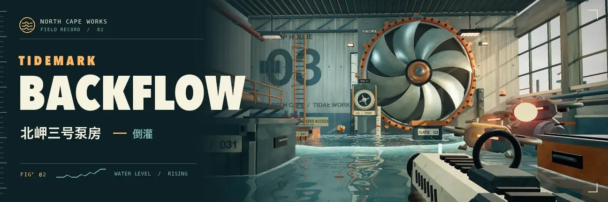
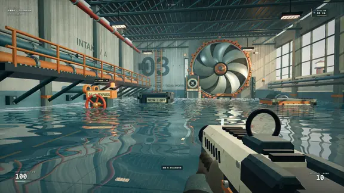
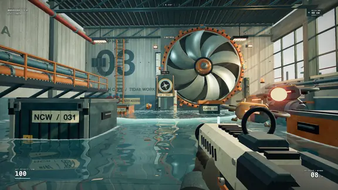

# 潮痕：倒灌

[][play]

一间正在进水的泵房，三轮失控的巡检机。**浏览器 FPS · 免下载 · 支持键鼠和触屏。**

[][play]

海水漫过货箱时，一把铆枪未必够用。西边有个红色旁通阀，叶轮旁有个黄环。等巡检机贴着水面飞近，你就知道它们是干什么的了。

[实机短片 · 1080p60 有声](https://github.com/ericyanpek/astra62-fps-demo/releases/download/v2.0.0/backflow-1080p60.mp4)　/　[下载离线版 · 单个 HTML](https://github.com/ericyanpek/astra62-fps-demo/releases/download/v2.0.0/tidemark-backflow.html)　/　[标题画面 · 1440p 原图](media/title.webp)

## 第一次进泵房

用支持 WebGL 的浏览器[打开游戏][play]，在标题画面点「进入三号泵房」。戴上耳机，可以听见旁通阀打开和主泵启动时的变化。

| 移动 | 战斗 | 与泵房交互 |
| :--- | :--- | :--- |
| **WASD** 移动 · **Shift** 奔跑 · **空格** 跳跃 | 鼠标瞄准 · **左键** 发射 · **右键** 聚焦 · **R** 换芯 | **E** 开阀或启动主泵 · **Esc** 暂停 |

**触屏：** 左拇指推摇杆，右拇指拖动画面瞄准。射击和换芯在右侧；靠近设备时会出现交互按钮。

## 一次水锤，三格实录

| 01　倒灌 | 02　泄压 | 03　退潮 |
| :--- | :--- | :--- |
| [](media/backflow.webp) | [](media/waterhammer.webp) | [](media/low-water.webp) |
| 去西边，拧开**红色旁通阀**。 | 朝**黄环**打一发。水锤能扫到贴水机，但够不着高挂机。 | 到**主泵**前按 **E**，看水面从货箱上退下去。 |

点上面任一格可看 **2560 × 1440 无损实机原图**。短片用同一款游戏逐帧录制，保留了游戏合成音效，剪去了部分移动和轮次等待。

## 一句提示词之后

Astra 6.2 用一句英文创作需求做出了第一版《潮痕》。留好 checkpoint 后，它又独立迭代了一轮，做出现在的《倒灌》。可以对照[两轮创作提示词](docs/experiment.md)、[第一版源码](https://github.com/ericyanpek/astra62-fps-demo/tree/v1.0.0)和[第二版发布记录](https://github.com/ericyanpek/astra62-fps-demo/releases/tag/v2.0.0)。

<details>
<summary><strong>从源码运行、验证或录制</strong></summary>

离线版和仓库根目录的 `index.html` 都能直接双击打开。场景、贴图和声音由代码生成，运行游戏不需要安装依赖。

- `src/` 包含场景、材质、玩法、音效和渲染源码。`hydraulics.js` 负责动态水面、旁通阀与水锤。Three.js 随附[原始许可证](src/LICENSE.three)。
- `python3 src/build.py` 从源码重新生成 `index.html`，无需 npm。
- `tools/verify.cjs` 用离线 Chrome 实际操作游戏，验证三轮通关、失败重开、掩体碰撞、水锤判定和触屏操作。
- `tools/record.cjs` 将 1080p60 片段保存到 `artifacts/`。验证和录制需要 Node.js、Playwright 和 Chrome，录制另需 FFmpeg。可用 `PLAYWRIGHT_MODULE` 指向已有的 Playwright 安装。

```sh
npm install --no-save --package-lock=false playwright
node tools/verify.cjs artifacts/qa
node tools/record.cjs
```

</details>

[play]: https://ericyanpek.github.io/astra62-fps-demo/
